<!-- Header -->

<!-- Typing -->

  

<!-- Terminal -->

  

<!-- Spotify -->

  

<!-- Snake -->
<picture>
  <source media="(prefers-color-scheme: dark)" srcset="https://raw.githubusercontent.com/solly1402/solly1402/output/github-snake-dark.svg" />
  <source media="(prefers-color-scheme: light)" srcset="https://raw.githubusercontent.com/solly1402/solly1402/output/github-snake.svg" />
  
</picture>

 

<i>⚡ 1% code by me, 99% by my AI buddy — 100% honest.</i>

<!-- Footer -->

